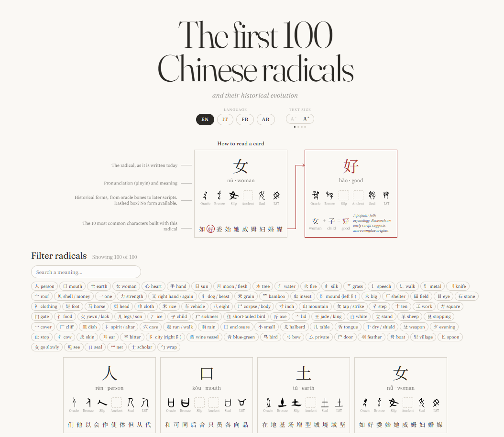

# 部首 · Chinese Radicals Explorer



An interactive visual explorer of the Chinese radicals (部首, _bùshǒu_), the building blocks used to classify and look up Chinese characters. Pick a radical to see its pinyin, its meaning, the characters built from it, and how its written form changed over time.

> 🎓 This is a **learning project** I built to practice JavaScript and React for Yan Holtz's D3 + React course. It is meant to be explored and read, not used as a reference dictionary.

---

## ✨ What you can do

- **Browse the radicals.** Explore 100 of the most productive of the 214 Kangxi radicals, and filter them by meaning.
- **Inspect a radical.** View its pinyin and its core meaning.
- **Explore derived characters.** Each card shows the ten most frequent characters that contain the radical. These are single characters (e.g. 性, 意, 情 contain 心), not multi-character words like 意思 or 感情.
- **See historical forms.** Follow the radical's evolution through six earlier scripts: oracle bone, bronze, Qin slip, ancient, small seal, and Liushutong. A dashed box means no form was available.
- **Switch language.** Radical names are available in English, Italian, French, and Arabic.

## 🧠 Why this project

Radicals are one of the most useful entry points into Chinese writing. Once you recognize them, unfamiliar characters stop looking like random strokes and start looking like meaningful compositions. I wanted to make that structure _visible_.

## 🛠️ Tech stack

| Layer         | Tools                                                      |
| ------------- | ---------------------------------------------------------- |
| Framework     | React + Vite (React only for now; D3 visuals planned)      |
| Data pipeline | Node.js build script                                       |
| Data sources  | Unicode Unihan, Jun Da's frequency list, Wikimedia Commons |

## 📦 How the data works

A small Node.js script (`scripts/build-radicals.mjs`) builds the dataset once, ahead of time, and saves it as a static JSON file that ships with the app. The JSON stores, for each historical form, the address of its image on Wikimedia Commons, so the **images load from Commons** in the browser when the app opens.

```
Unihan + Jun Da's list + Wikimedia Commons API  ──(build script, run manually)──▶  radicals.json  ──▶  React app (images loaded from Commons)
```

- **Radical membership, pinyin, and definitions** come from the [Unicode Unihan database](https://www.unicode.org/charts/unihan.html).
- **Derived characters:** for each radical, the ten shown are the most frequent ones in Jun Da's [Modern Chinese character frequency list](https://lingua.mtsu.edu/chinese-computing/statistics/).
- **Historical forms** are the images shown in [Wiktionary](https://en.wiktionary.org/)'s "Historical forms" tables, which are hosted on [Wikimedia Commons](https://commons.wikimedia.org/). Rather than scraping Wiktionary pages, the script follows Wiktionary's file-naming convention (e.g. `目-oracle.svg`, `目-seal.svg`) and asks the Commons API which files exist, along with each file's license and author.

When calling the Commons API, the script follows Wikimedia's etiquette for automated clients:

- It sends a **descriptive User-Agent** that identifies the project.
- It sends **requests one after another**, never in parallel, grouping up to 50 file names per request and pausing between requests.
- If the server says it is busy, it **waits and retries**, respecting the server's `Retry-After` header.
- It **caches answers** (`data-raw/commons-cache.json`), so later runs only ask about files they haven't seen before.
- It is **run only when the data needs refreshing**, not on every visit.

## 🚀 Getting started

```bash
# 1. Clone the repository
git clone https://github.com/manuelam00/chinese-radicals-explorer.git
cd chinese-radicals-explorer

# 2. Install dependencies
npm install

# 3. Start the development server
npm run dev
```

### Rebuilding the dataset (optional)

The prepared dataset is already included, so you only need this to update it. It requires Node.js 18+ and two source files placed in `data-raw/`:

- the extracted [Unihan database](https://www.unicode.org/Public/UCD/latest/ucd/Unihan.zip) files (`Unihan_*.txt`)
- Jun Da's character frequency list, saved as UTF-8 text

```bash
node scripts/build-radicals.mjs \
  --unihan ./data-raw/Unihan \
  --freq ./data-raw/char_freq.txt \
  --out ./src/data/radicals.json
```

## 🗂️ Project structure

```
chinese-radicals-explorer/
├── data-raw/          # Source files (Unihan, frequency list) and the Commons cache
├── docs/              # Images used in this README
├── public/            # Static assets (favicon, icons)
├── scripts/           # Build script that prepares the dataset
├── src/               # App source code
├── index.html         # App entry point
├── vite.config.js     # Vite configuration
├── .oxlintrc.json     # Linter configuration (oxlint)
├── LICENSE            # MIT license for the code
└── package.json
```

## 📝 Notes & caveats

- **Data quality.** Unihan definitions are short glosses, and historical forms on Commons are not available for every radical, so some cards show empty cells.
- **Variant forms share a radical.** Unihan doesn't distinguish positional variants (氵 vs 水, 忄 vs 心, 扌 vs 手), so they are grouped together. Historical forms are shown for the full form (氵 → 水).
- **月 also covers 肉.** Most characters with 月 on the side (脸, 脑, 胖) are classified under 肉 "flesh", so the 月 card includes both.
- **Translations.** The Italian, French, and Arabic radical names were drafted with the help of Claude and are not taken from a dictionary.
- **Snapshot in time.** The dataset reflects its sources as of the last build on October 20, 2026.

## 🤝 How it was built

This app was built in close collaboration with **[Claude](https://claude.ai)**, which I used as a coding partner throughout the project.

- **My part:** the idea and scope, the choice of data and what to show, design and interaction decisions, the initial code, testing, reviewing, and iterating on every piece.
- **Claude's part:** writing and debugging much of the React code, explaining concepts as we went, and advising on the data pipeline (for example, using the Commons API instead of scraping, and the Wikimedia etiquette described above).

This project was a learning exercise. With my current knowledge, I could only have built a much simpler version on my own. Instead, I chose to be guided step by step, so I could aim for a better result while learning how a project's folders and files grow as it develops. At each stage, I focused on understanding why the code is structured the way it is, which made the project a hands-on way to learn the logic behind JavaScript and React.

## 📜 License & data attribution

- **Unihan data:** © Unicode, Inc., used under the [Unicode License](https://www.unicode.org/license.txt)
- **Character frequencies:** from Jun Da's Modern Chinese character frequency list
- **Historical forms:** images from Wikimedia Commons, each under its own license; the license and author of each image are recorded in the dataset

## 🙏 Acknowledgements

- **[Yan Holtz's D3 + React course](https://www.react-graph-gallery.com/react-d3-dataviz-course)**, which this project grew out of
- The journal **[Feral Worlding](https://www.feral-worlding.xyz/)**, which inspired the header design
- The Unicode Consortium, Jun Da, the Wiktionary editors, and the Wikimedia Commons contributors, whose work makes this dataset possible
- Claude (Anthropic), my coding collaborator on this project
